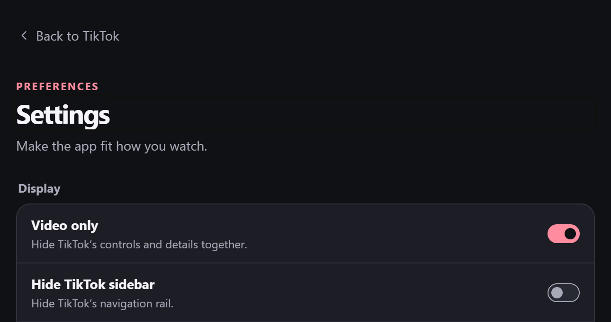
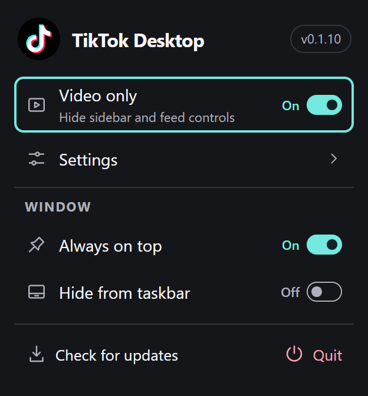

  

<h1 align="center">TikTok Desktop</h1>

A compact TikTok player for Windows 11 with global playback shortcuts and quick controls in the system tray.

  <a href="https://github.com/JNathan34/Tiktok-Desktop/releases/latest"><strong>Download the latest release</strong></a>

<strong>x64</strong> for Intel and AMD PCs · <strong>ARM64</strong> for Windows on Arm

<table>
  <tr>
    <td align="center" valign="top" width="67%">
      
       <strong>Display settings</strong>
    </td>
    <td align="center" valign="top" width="33%">
      
       <strong>System tray</strong>
    </td>
  </tr>
</table>

## What you can do

- **Keep TikTok in a compact window.** Turn on **Video only** to hide the feed controls and details, or adjust them individually. The app remembers your window size and position.
- **Control playback from another app.** Use the global shortcuts below while TikTok Desktop is running.
- **Use the system tray.** Left-click the TikTok icon to open the app. Right-click for **Video only**, Settings, window controls, and updates.

| Global shortcut | Action |
| --- | --- |
| **Ctrl + Shift + ↑ / ↓** | Previous or next TikTok |
| **Ctrl + Shift + ← / →** | Seek backward or forward five seconds |

To set a shortcut for showing or hiding the window, open **Settings → Keyboard and mouse → Show or hide TikTok**, choose a key, and select **Save**. Windows may reserve some combinations. Settings shows which shortcuts the app could register.

## Install and update

Download the installer for your PC from **Assets** on the latest release. Run Setup, then open **TikTok Desktop** from Start. To update an existing installation, right-click the tray icon and select **Check for updates**. [Latest release](https://github.com/JNathan34/Tiktok-Desktop/releases/latest)

Setup, sign-in, and playback help

- **Setup** uses Microsoft Edge WebView2 and can download it if needed. Windows may show a publisher warning for the installer. The app verifies in-app updates with a separate signature.
- **Sign in** through TikTok’s login menu. If a popup is blocked, select **Use QR code** and scan it with a phone already signed in. TikTok also offers phone or email sign-in when available for your account.
- **Playback keys** work with TikTok in focus. Use **↑ / ↓** or scroll to move between videos, **Space** to play or pause, **M** to mute, and **F** or **Esc** for fullscreen. **Ctrl + ,** opens Settings.
- **Custom icon** support uses an ICO file at `%LOCALAPPDATA%\com.tiktokdesk.client\app-icon.ico`. Reopen the app after saving it. Windows also lets you change a pinned shortcut’s icon in its properties.

[Build from source](docs/building.md) · [Report an issue](https://github.com/JNathan34/Tiktok-Desktop/issues/new)

TikTok Desktop is an independent project and is unaffiliated with TikTok.
