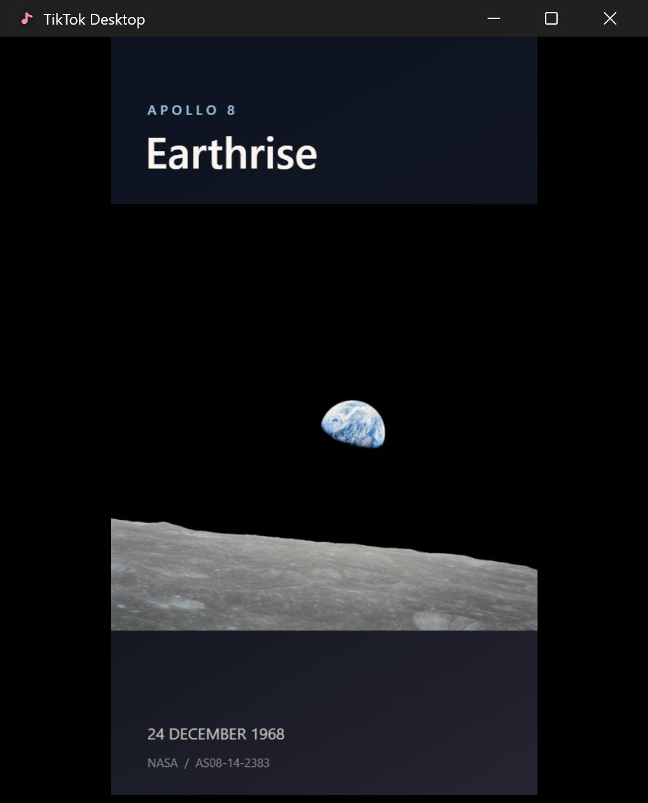

  

<h1 align="center">TikTok Desktop</h1>

An independent Windows 11 app for watching TikTok with a compact player, custom display controls, and a native system tray menu.

  <a href="https://github.com/JNathan34/tiktok-desktop-windows/releases/latest"><strong>Download for Windows 11</strong></a>
  · <a href="#screenshots">Screenshots</a>
  · <a href="#quick-controls">Quick controls</a>
  · <a href="docs/building.md">Build from source</a>

## Screenshots

<table>
  <tr>
    <td align="center" valign="top" width="40%">
      
       <strong>Compact playback</strong> Video only mode with sample media.
    </td>
    <td align="center" valign="top" width="60%">
      
       <strong>Display settings</strong> Hide individual controls and adjust zoom or video sizing.
    </td>
  </tr>
</table>

The playback screenshot uses [NASA’s Earthrise photograph](https://science.nasa.gov/resource/image-earthrise/) as sample media. Image courtesy of the Earth Science and Remote Sensing Unit, NASA Johnson Space Center. Photo ID AS08-14-2383.

## Install

1. Open the [latest release](https://github.com/JNathan34/tiktok-desktop-windows/releases/latest) and choose the installer for your PC.

   | Windows PC | Installer under **Assets** |
   | --- | --- |
   | Snapdragon or another Windows on Arm device | File ending in `arm64-setup.exe` |
   | Intel or AMD 64-bit device | File ending in `x64-setup.exe` |

2. Run the installer, then open **TikTok Desktop** from Start.

The installer uses Microsoft Edge WebView2 and can download its bootstrapper if needed. Windows may display a publisher warning because the installers are Authenticode-unsigned. In-app updates have a separate signature that the app verifies.

## Quick controls

<table>
  <tr>
    <td valign="top" width="55%">
      <strong>Right-click the TikTok Desktop icon in the Windows system tray.</strong>
      <ul>
        <li><strong>Open TikTok</strong> restores the window.</li>
        <li><strong>Settings</strong> opens display, playback, and keyboard options.</li>
        <li><strong>Always on top</strong> keeps the window above other apps.</li>
        <li><strong>Hide from taskbar</strong> removes the running taskbar button while the window stays open and playback continues.</li>
        <li><strong>Check for updates</strong> checks GitHub Releases.</li>
      </ul>
    </td>
    <td align="center" valign="top" width="45%">
      
    </td>
  </tr>
</table>

**Show or hide TikTok from any app.** Go to **Settings → Keyboard and mouse → Show or hide TikTok**, choose a shortcut, and select **Save**. Press it once to hide the window and pause playback, and again to restore the window. This works while the app is running in the tray. Select **Clear** to turn the shortcut off.

| Shortcut | Action |
| --- | --- |
| Mouse wheel, **↑** or **↓** | Move between feed videos |
| **Ctrl + Shift + ↑ / ↓** | Go to the previous or next TikTok from any app |
| **Ctrl + Shift + ← / →** | Seek back or forward five seconds from any app |
| **Space** | Play or pause the current video |
| **M** | Toggle mute |
| **F** or **Esc** | Enter or leave fullscreen |
| **Ctrl + ,** | Open Settings |
| **Alt + F4** | Close the app |

The Ctrl + Shift arrow shortcuts work while TikTok Desktop is running. Settings shows any combinations Windows could not register. The single-key playback shortcuts work when the TikTok view has focus and leave text entry and keyboard-focused controls available. Windows media controls can also play or pause the visible video.

## Make the window fit

In **Settings → Display**, turn on **Video only** to hide the feed controls and details together. To change individual parts, use **Hide TikTok sidebar**, **Hide reaction buttons**, or the switches for the arrows, video details, and playback bar. Use **Page zoom** to scale TikTok, or **Video sizing** to fit the whole picture or fill the frame. **Reset display** restores the defaults.

Use a custom app icon

Save a square Windows ICO file as `%LOCALAPPDATA%\com.tiktokdesk.client\app-icon.ico`, then reopen the app. Use a multi-resolution ICO for high-DPI displays. To customise a pinned shortcut, select the same ICO in that shortcut’s Windows properties.

## Sign in and update

- **Sign in.** Use TikTok’s own login menu. If a popup is blocked, select **Use QR code** and scan it with a phone already signed in to your TikTok account. Phone or email sign-in is also available when configured on your account. Google sign-in is unavailable in the embedded browser.
- **Update.** The app checks GitHub Releases when it opens and asks before installing a newer version. You can also choose **Check for updates** from the tray. If you’re still on v0.1.0, install the current release manually once to add the updater.

In **Settings**, **Pause when minimised** stops playback when you minimise the window. **Clear disk cache** keeps your sign-in, and **Log out locally** clears this app’s TikTok session. Hardware acceleration changes take effect when you reopen the app.

## Build or report a problem

- [Build, release, and security documentation](docs/building.md)
- [Report an issue](https://github.com/JNathan34/tiktok-desktop-windows/issues/new) with your app version, Windows architecture, and steps to reproduce it.

Built with Tauri 2, Rust, WebView2, and TypeScript. TikTok Desktop is an independent project and is unaffiliated with TikTok.
